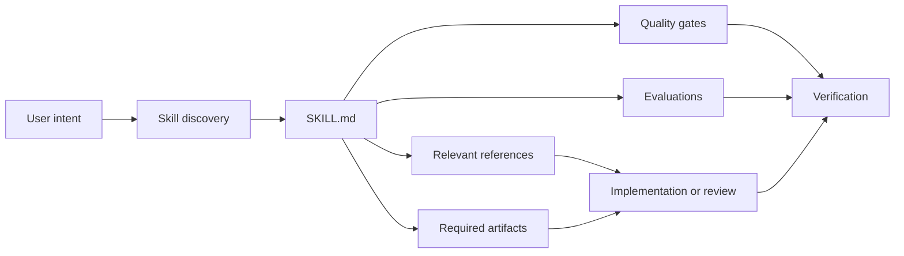

<div align="center">

# Skills for SaaS

### The open skill system for production-grade SaaS engineering.

Build multi-tenant, scalable, secure, API-first, AI-driven SaaS products with reusable engineering workflows that work across agents, languages, frameworks, clouds, and runtimes.

[](spec/skill-format.md)
[](docs/compatibility.md)
[](docs/catalog.md)
[](docs/index.md)
[](LICENSE)
[](CHANGELOG.md)

[Explore the catalog](docs/catalog.md) · [Get started](docs/getting-started.md) · [Author a skill](docs/authoring.md) · [Contribute](CONTRIBUTING.md)

</div>

---

## Why this exists

AI coding agents can generate code quickly. They do not automatically preserve the difficult parts of SaaS engineering:

- tenant isolation across APIs, data, jobs, caches, events, files, search, and analytics;
- stable authorization, identity, billing, metering, and entitlement boundaries;
- safe migrations, idempotency, retries, observability, incident response, and recovery;
- AI evaluation, prompt contracts, provider abstraction, governance, cost, and user control;
- consistent decisions across long-running projects and different agents.

**Skills for SaaS turns those practices into reusable, inspectable, versioned workflows.**

A skill does more than provide advice. It defines when to activate, what evidence to inspect, which steps to follow, what artifacts to produce, which quality gates must pass, and which anti-patterns must be rejected.

## What makes it different

| Principle | What it means |
|---|---|
| **Runtime-agnostic** | No Node.js, Bun, Deno, framework, language, database, or cloud is required to use the skills. |
| **Agent-neutral** | Skills are plain Markdown, JSON, and YAML-compatible metadata. They can be consumed manually or adapted to different coding agents. |
| **Multi-tenancy first** | Tenant identity and isolation are treated as architecture, not as filters added after the MVP. |
| **Spec-driven** | Product intent, contracts, decisions, tests, migrations, and rollout evidence precede irreversible implementation. |
| **AI-evaluated** | AI features require typed contracts, evaluations, fallback behavior, governance, latency, cost, and safety controls. |
| **Production-oriented** | Every relevant workflow includes failure behavior, observability, security, migration, and rollback. |
| **Progressive disclosure** | Agents load compact skill instructions first and deeper references only when needed. |
| **Open source** | The catalog, specifications, evaluations, governance, and maintenance tools are public and reviewable. |

## The system



## Core catalog

The initial release contains **63 skills** across the complete SaaS lifecycle.

| Domain | Examples |
|---|---|
| Foundation | SaaS bootstrap, spec-driven development, repository architecture, ADRs, project context |
| Architecture | Domain modeling, modular monoliths, service boundaries, scalability |
| Tenancy | Multi-tenant architecture, context propagation, isolation, tenant lifecycle |
| Identity | Authentication, RBAC/ABAC, memberships, invitations, machine identities |
| Data | Schema design, zero-downtime migrations, RLS, retention, export, deletion |
| APIs | API-first design, OpenAPI, idempotency, concurrency, pagination, errors |
| Events & integrations | Domain events, outbox/inbox, webhooks, OAuth, provider adapters |
| AI | AI feature specs, model abstraction, prompts, RAG, agents, evaluations, governance |
| Billing | Subscriptions, usage metering, entitlements |
| Platform | Configuration, extensions, i18n, jobs, observability, resilience |
| Security | Threat modeling, secrets, audit logging, privacy and compliance |
| Testing | Test strategy, tenant-isolation testing, contracts, performance |
| Delivery | CI/CD, infrastructure, releases, versioning |
| Operations | Incidents, backups, disaster recovery, cost governance |
| Product | MVP scope and product analytics |

Browse the complete [skill catalog](docs/catalog.md).

## Quick start

No package installation is required.

```bash
git clone https://github.com/YOUR-ORG/skills-for-saas.git
cd skills-for-saas
```

Open a skill directly:

```text
skills/tenancy/multi-tenant-architecture/SKILL.md
```

Copy only the skills needed by a project:

```bash
mkdir -p ../my-saas/.agent/skills
cp -R skills/tenancy/multi-tenant-architecture ../my-saas/.agent/skills/
cp -R skills/api/api-first-design ../my-saas/.agent/skills/
cp -R skills/security/threat-modeling ../my-saas/.agent/skills/
```

Then ask your agent:

```text
Use the multi-tenant-architecture, API-first-design, and threat-modeling
skills to design the first production vertical slice of this SaaS.
Inspect the current specifications and code before proposing changes.
```

Manual use works the same way: read the selected `SKILL.md`, follow the workflow, and verify every quality gate.

## Skill anatomy

```text
skills/<domain>/<skill-name>/
├── SKILL.md
├── references/
│   └── checklist.md
└── evals/
    └── evals.json
```

```yaml
---
name: multi-tenant-architecture
description: Choose and document a tenancy model...
license: Apache-2.0
compatibility: Runtime-agnostic and vendor-neutral...
metadata:
  category: tenancy
  version: 0.1.0-alpha.1
  maturity: alpha
  tags:
    - multi-tenancy
    - isolation
---
```

The main document remains concise. Deep references, examples, scripts, or assets may be added only when they improve the workflow and stay inside the skill directory.

## Curated bundles

Bundles are lists, not runtime packages:

- **MVP Foundation** — the minimum serious architecture for a launchable SaaS.
- **AI SaaS** — AI contracts, models, RAG, agents, evaluations, governance, metering, and privacy.
- **Enterprise SaaS** — stronger isolation, identity, lifecycle, compliance, reliability, and operations.

See [`bundles/`](bundles/README.md).

## Repository structure

```text
.
├── skills/                 # Portable, self-contained skills
├── bundles/                # Curated skill collections
├── catalog/                # Machine-readable discovery metadata
├── spec/                   # Public format and compatibility contracts
├── schemas/                # JSON Schemas
├── templates/              # Authoring and SaaS specification templates
├── examples/               # Runtime-neutral integration examples
├── adapters/               # Guidance for different agent environments
├── docs/                   # Documentation
├── tools/                  # Optional Python standard-library maintenance tools
└── .github/                # CI, issue forms, and contribution workflows
```

## Runtime independence

The core repository consists of Markdown, JSON, YAML, and text files. **Using the skills requires no runtime.**

The optional maintainer tools under `tools/` use only the Python standard library. They validate metadata, links, catalogs, and release archives. They are not required by skill consumers and can be replaced by any implementation that follows the public schemas.

## Compatibility

The portable source format is designed for:

- manual engineering playbooks;
- coding agents that can read repository instructions;
- agent skill directories;
- IDE rules and custom instructions;
- multi-agent orchestration;
- internal registries and marketplaces.

Product-specific adapters are intentionally thin. The skill remains the source of truth.

Read [Compatibility](docs/compatibility.md).

## Project status

`0.1.0-alpha.1` is the revised public alpha baseline.

The format is usable now, but public schemas may still evolve before `1.0.0`. Alpha releases prioritize real-world validation, security review, catalog quality, and compatibility experiments.

## Contributing

High-quality contributions are welcome:

- new skills;
- sharper quality gates;
- real failure cases;
- adversarial evaluations;
- compatibility adapters;
- corrections and clearer references.

Start with [CONTRIBUTING.md](CONTRIBUTING.md) and [Skill Authoring](docs/authoring.md).

## Security

A skill is an instruction source, not a security boundary. Tools, APIs, databases, sandboxes, and approval workflows must enforce security independently.

Report vulnerabilities privately according to [SECURITY.md](SECURITY.md).

## License

Apache License 2.0. See [LICENSE](LICENSE) and [NOTICE](NOTICE).

<div align="center">

**Build faster without treating production engineering as optional.**

</div>
